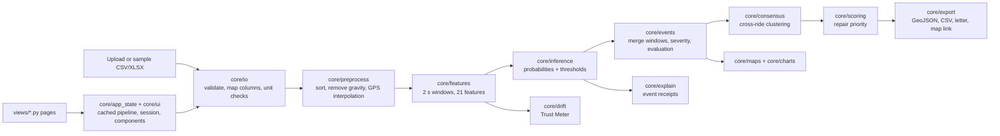

# RoadPulse
   [](https://colab.research.google.com/github/mannatkalani/road_sensor/blob/main/notebooks/road_sensor.ipynb)
**Find speed breakers and potholes from smartphone sensor data, put them on a map, and rank them for repair.**

RoadPulse is a multi-page Streamlit app built on a window-based machine-learning model. Upload ride files (accelerometer, gyroscope, speed, GPS), and the app detects road events, explains each detection, lets you choose how cautious the detector is, confirms spots across rides, and produces a repair priority list with exports.

> **Read this first: the training data is simulated.** The model was trained and tested on a sensor simulator, not on recorded roads. All scores describe how well it recovers simulated patterns. They say nothing certain about real-world accuracy. The app shows this notice on every page and in the Model Card.

<!-- Replace with a screen recording: docs/demo.gif -->


## What it does

| Page | What you get |
|---|---|
| Upload & Analyze | Upload CSV/Excel or pick sample rides, friendly validation (columns, units, sampling rate), a ride map, the vibration signal with detected events, and an event table you can export |
| Event Receipts | For any event: waveform vs the average event of that type, confidence, severity, the top 5 signals that drove the prediction in plain English, and a downloadable PNG/HTML card |
| Operating Modes | Driver Alert (high precision), Municipal Audit (high recall), Balanced, or custom per-class thresholds, with live events, false alarms per km and (with labels) precision/recall |
| Consensus Map | Clusters events across rides (haversine DBSCAN) so spots seen by several rides gain confidence |
| Trust Meter | Compares a ride with the training data, gives a 0-100 trust score, explains why, and recommends an operating mode |
| Priority Queue | Repair ranking = severity x confirmations x low-speed exposure, GeoJSON/CSV export, a complaint-letter draft and a Google Maps route link |
| Model Card | Model comparison, leave-one-route-out results, per-class metrics, limitations and a sim-to-real roadmap |

## Architecture



Pages contain no business logic. They call `core/app_state.py` (cached pipeline and session state) and `core/ui.py` (rendering helpers), which call the framework-free modules in `core/`.

## Quick start

```bash
python -m venv .venv && source .venv/bin/activate     # Python 3.11
pip install -r requirements.txt
streamlit run app.py
```

The repository ships with the trained model and sample rides in `models/` and `data/`. To rebuild them from the simulated dataset:

```bash
python tools/make_assets.py --dataset path/to/pune_road_sensor_dataset.csv
```

This regenerates the model, `reference_stats.json`, `training_windows.csv`, the metric tables and the sample rides. Pickled models depend on library versions, so keep `requirements.txt` pinned (or rebuild the assets with your versions).

### Input format

20 Hz works best (other rates can be resampled in the app). Required columns: `time_s, speed_kmh, acc_x, acc_y, acc_z, gyro_x, gyro_y, gyro_z`. Strongly recommended: `lat, lon`. Optional: `ride_id, route_id, label` (0 smooth, 1 speed breaker, 2 pothole; enables measured precision/recall). Accelerometer values are in m/s² **including gravity** (acc_z about 9.8 with the phone flat); gyroscope values are in rad/s. The upload page offers a CSV template and a column-mapping tool.

## Tests

```bash
python -m pytest -q
```

85 deterministic tests cover the feature pipeline, input validation, event merging, consensus, scoring, drift, explanations, maps, charts, exports, and headless renders of every page (Streamlit `AppTest`). The page tests are skipped if the model assets are missing.

## Docker

```bash
docker build -t roadpulse .
docker run -p 8501:8501 roadpulse
```

## Deployment notes

- **Streamlit Community Cloud:** point it at `app.py`, choose Python 3.11, and keep `requirements.txt` as is. The sample assets are small enough to commit.
- **Any container host** (Cloud Run, Fly.io, Azure Container Apps, a VM): use the Dockerfile; the app listens on 8501 and exposes `/_stcore/health`.
- **Uploads and privacy:** uploaded rides are processed in server memory for the session and are not written to disk by the app. Streamlit's in-memory cache keeps computed results for identical inputs until the process restarts, so do not host personal location data on a shared deployment without adding authentication.
- **Upload size:** limited to 200 MB in `.streamlit/config.toml`; reduce it for public deployments.
- **Fonts:** the theme loads Space Grotesk, JetBrains Mono and Inter from Google Fonts and falls back to system fonts offline.
- **Maps:** CARTO dark tiles built on OpenStreetMap data. No API keys. Check the tile providers' usage terms before heavy public traffic.

## Design

"Asphalt & Signage": near-black asphalt backgrounds, amber for speed breakers and the accent, red for potholes, teal for smooth road. Space Grotesk for headings, JetBrains Mono for numbers, Inter for body text. The single decorative motif is the dashed road centerline on each page header.

## Honest limitations

- **Simulated training data.** Real roads, phones, mounts, vehicles and drivers will behave differently.
- **Small test set.** Only route D (2 rides) was held out, so every score has wide error bars. XGBoost and Random Forest are statistically tied.
- **Sample rides R01, R05 and R10 are on training routes,** so results there are optimistic. R11 and R12 are on the held-out route.
- **Single phone position** (flat, z-axis up) is assumed.
- **Consensus on sample data:** sample rides cover different roads, so they rarely overlap. The "Demo repeat passes" tab fabricates repeat passes from one ride (same events, fresh noise and GPS jitter); this demonstrates the workflow but is not independent evidence.
- **False alarms without labels are estimates** based on the model's own confidence, which assumes it is well calibrated.
- **Trust Meter** compares rides with statistics from the simulated routes.
- **Complaint letters** are drafts from an automated model and ask for on-site verification. The app has no integration with Google, Uber or any municipality; it only produces exports and a Google Maps deep link.

## Roadmap

1. Record real rides with a fixed mount and label the events.
2. Retrain with real routes, calibrate probabilities, and test across drivers, vehicles and phones.
3. Tune per-class thresholds for real use cases.
4. Merge near-duplicate detections across passes automatically and add a live-recording mode.
5. Pilot a municipal audit and compare the ranking with inspectors' findings.

## Repository layout

```
app.py                  entry point: navigation, theme, honesty banner
.streamlit/config.toml  dark theme, hidden toolbar, no raw tracebacks
assets/style.css        fonts, cards, tiles, tabs, buttons
core/                   framework-free logic (plus app_state.py and ui.py glue)
views/                  seven pages
tests/                  unit tests + page smoke tests
tools/make_assets.py    rebuilds models/ and data/ from the simulated dataset
models/ data/           trained model, reference statistics, metric tables, sample rides
```
